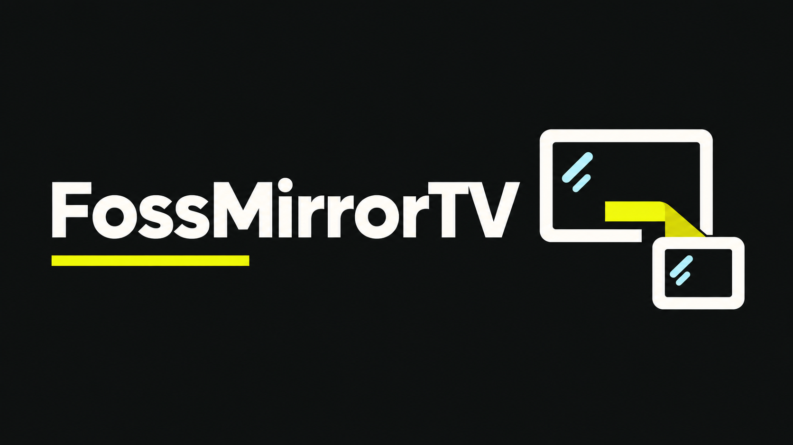
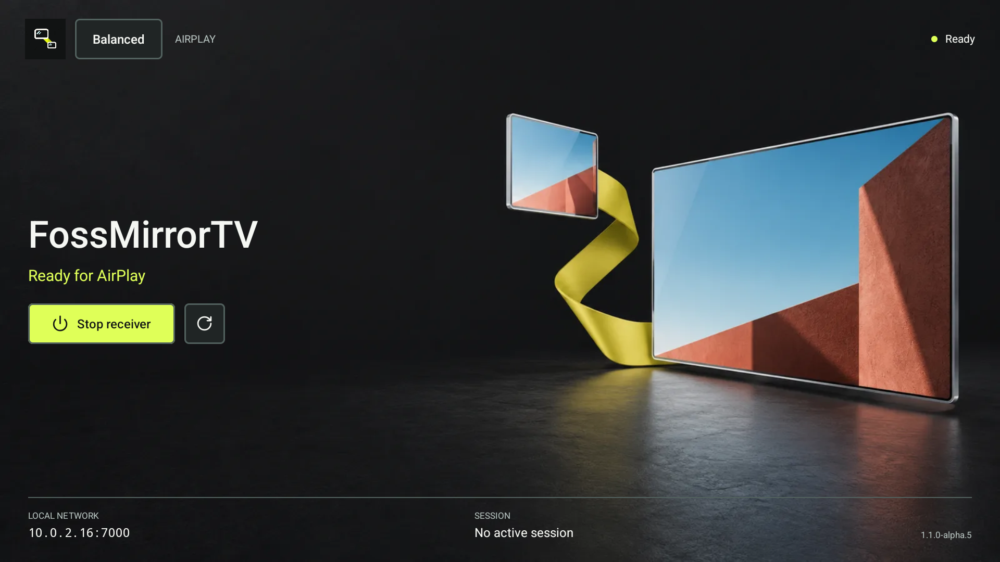
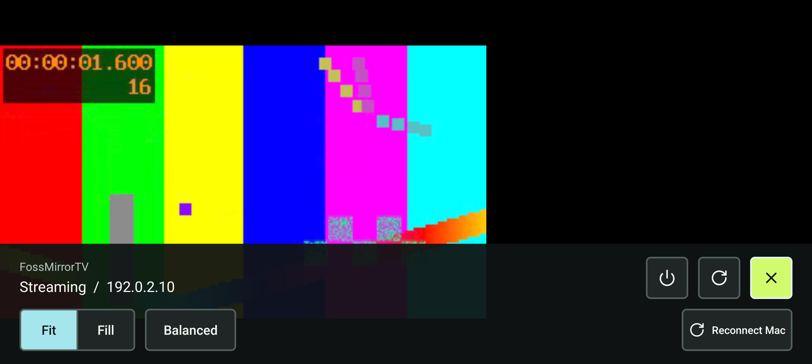

<div align="center">
  
  <h1>FossMirrorTV</h1>
  <p><strong>Your Mac. Your Android screen. No cables.</strong></p>
  <p>An open-source AirPlay receiver for Android TV and phones, built for your local network.</p>
  <p>
    
    
    
    <a href="LICENSE"></a>
  </p>
  <p>
    <a href="#build-from-source"><strong>Build it</strong></a>
    &nbsp; &middot; &nbsp;
    <a href="docs/TESTING.md">Test evidence</a>
    &nbsp; &middot; &nbsp;
    <a href="https://github.com/Sal7one/AirplayToAnyAndroid/issues">Report an issue</a>
    &nbsp; &middot; &nbsp;
    <a href="docs/SHARE.md">Share the project</a>
  </p>
</div>

## On The Big Screen

| Ready for your Mac | Controls within reach |
| :---: | :---: |
|  |  |

Actual emulator screenshots from earlier alpha builds. Playback uses a synthetic video fixture, not a captured Mac desktop. [Image provenance](docs/screenshots/README.md).

## What You Get

| Feature | In the app |
| --- | --- |
| Screen and sound | H.264 video with Android MediaCodec; PCM, ALAC, and AAC-ELD audio, gated by device capabilities. |
| Remote-friendly controls | Fit / Fill, saved Responsive / Balanced / Smooth modes, and disconnect without stopping the receiver. |
| More than one receiver | Stable generated device names distinguish your TV and phone in the Mac's mirroring menu. |
| Local by design | No account, cloud relay, or analytics in the app. Your devices talk over the LAN. |

## Connect

1. Install the APK on your Android TV and open **FossMirrorTV**.
2. Connect your Mac and TV to the same trusted Wi-Fi or Ethernet network.
3. On your Mac, open **Control Center > Screen Mirroring** and select your receiver, for example **FossMirrorTV - TV A1B2C3**.

The receiver name shown below the app title matches the name on your Mac. No separate Mac sender app is needed.

> **An honest alpha:** real Mac video and audio worked on one TCL/MediaTek TV. This is not a universal compatibility claim. Live HEVC/4K, measured latency gains, and extended gap-free audio are not verified. There is no PIN or trusted-device authorization: use a trusted LAN and never port-forward the receiver.

## Build From Source

Use JDK 17+, Android SDK 36, the NDK, and CMake 3.22.1.

```bash
git clone https://github.com/Sal7one/AirplayToAnyAndroid.git
cd AirplayToAnyAndroid
./gradlew :app:assembleDebug :app:testDebugUnitTest
```

The development APK is `app/build/outputs/apk/debug/app-debug.apk`. For a signed build, run `bash scripts/build-release.sh`; it creates or reuses your own signing key outside Git. Back that key up privately. Debug-signed builds cannot update a release-signed installation in place.

**Source-first publication:** no matching public APK has been published yet. Existing private alpha.6 binaries predate the crypto dependency update. Google Play readiness is still a separate release gate.

---

**Checked:** 227 host tests and debug / unsigned release builds passed on the exported source across four ABIs. Seven source-export tests passed. The 46 Android checks belong to the earlier alpha.6 build; the crypto update still needs Android runtime and TV/Mac checks. [Evidence](docs/TESTING.md) &middot; [Release gates](docs/PUBLIC_RELEASE.md).

**Built with:** Android MediaCodec / AudioTrack, JmDNS, Bouncy Castle, PlayFair, and Apple ALAC. Thanks to [UxPlay](https://github.com/FDH2/UxPlay), [PhairPlay](https://github.com/mazer666/PhairPlay), and the other [reference projects](docs/protocol/reference-integration.md). Component origins and licenses are in [NOTICE.md](NOTICE.md).

An independent project, not affiliated with or certified by Apple or Google. AirPlay is an Apple trademark.

[GPL-3.0-only](LICENSE) &middot; [Privacy](PRIVACY.md) &middot; [Security](SECURITY.md) &middot; [Third-party notices](NOTICE.md) &middot; [Public-release checklist](docs/PUBLIC_RELEASE.md)
